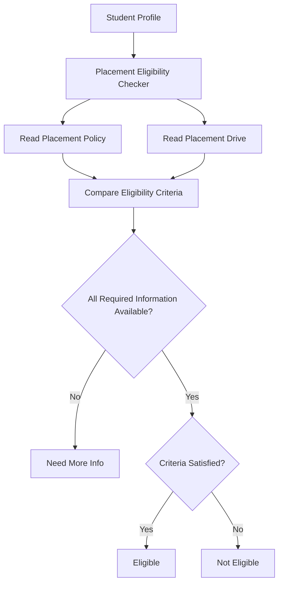

# Placement Eligibility Checker — Demo Knowledge Base

<p align="center">
  
  
  
</p>

<p align="center">
  <strong>Know your eligibility. Explore placement opportunities. Prepare with confidence.</strong>
</p>

<p align="center">
  A synthetic knowledge base designed to support an AI-powered Placement Eligibility Checker agent by providing placement-drive information, eligibility criteria, and evaluation policies.
</p>

<p align="center">
  <a href="#overview">Overview</a> •
  <a href="#features">Features</a> •
  <a href="#knowledge-base-structure">Knowledge Base</a> •
  <a href="#usage">Usage</a> •
  <a href="#author">Author</a>
</p>

---

## Table of Contents

- [Overview](#overview)
- [Problem Statement](#problem-statement)
- [Features](#features)
- [Knowledge Base Structure](#knowledge-base-structure)
- [Eligibility Evaluation](#eligibility-evaluation)
- [Technology and Format](#technology-and-format)
- [Usage](#usage)
- [Important Disclaimer](#important-disclaimer)
- [Future Roadmap](#future-roadmap)
- [Author](#author)

---

## Overview

**Placement Eligibility Checker** is a demo knowledge base created to support an AI agent that evaluates student eligibility for placement opportunities.

It contains synthetic placement-drive announcements and a structured placement policy that defines how eligibility should be interpreted.

The knowledge base is designed to help an AI agent compare student profiles against placement requirements and return clear eligibility verdicts.

## Problem Statement

Students often need to compare their academic records and personal eligibility details against different placement-drive requirements.

This project demonstrates how an AI agent can simplify that process by:

- Organizing placement-drive information.
- Understanding eligibility requirements.
- Comparing student profiles with placement criteria.
- Identifying missing information.
- Providing clear eligibility results.

## Features

### 1. Placement Drive Dataset

- Multiple synthetic placement announcements.
- Company-specific eligibility criteria.
- Academic requirements and branch restrictions.
- Application deadlines.
- Required document lists.

### 2. Eligibility Policy

- CGPA requirements.
- Active backlog restrictions.
- 10th and 12th percentage criteria.
- Academic gap conditions.
- Graduation year requirements.
- Previous campus offer conditions.

### 3. Structured Eligibility Evaluation

The policy defines three possible verdicts:

- **Eligible** — All stated criteria are satisfied.
- **Not eligible** — At least one stated criterion is not satisfied.
- **Need more info** — Required student information is missing.

### 4. Evidence-Based Responses

- Uses the supplied placement-drive data.
- Avoids inventing eligibility requirements.
- Identifies missing student information.
- Provides consistent evaluation rules.

---

## Knowledge Base Structure

```text
placement-eligibility-demo/
│
├── README.md
│
├── placement-drives.md
│
└── placement-policy.md
```

| File | Purpose |
|---|---|
| `placement-drives.md` | Synthetic placement announcements and requirements |
| `placement-policy.md` | Eligibility rules and evaluation instructions |
| `README.md` | Project documentation |

---

## Eligibility Evaluation

The knowledge base supports a structured evaluation workflow.



## Technology and Format

| Component | Technology |
|---|---|
| Knowledge Base | Markdown |
| Placement Data | Structured Markdown |
| Eligibility Rules | Policy-based instructions |
| AI Integration | Placement Eligibility Checker agent |

---

## Usage

1. Provide the student's academic and placement profile.
2. Supply the placement-drive dataset and eligibility policy to the AI agent.
3. Select the placement opportunity to evaluate.
4. Compare the student profile against the stated requirements.
5. Return an eligibility verdict with supporting criteria.

---

## Important Disclaimer

This repository contains **fictional and synthetic demonstration data**.

All company names, placement deadlines, eligibility requirements, and document lists are created for demonstration purposes.

They do not represent actual company hiring criteria or official college placement policies.

---

## Future Roadmap

- [ ] Expand the synthetic placement dataset.
- [ ] Improve structured student-profile evaluation.
- [ ] Add more eligibility scenarios.
- [ ] Integrate with a complete AI agent workflow.
- [ ] Explore automated placement notifications.
- [ ] Develop a user-friendly eligibility dashboard.

---

## Author

**Manjunath Halli**

Computer Science Engineering Student | AI | Cloud Computing | Software Development

- GitHub: [@manjunath-novus](https://github.com/manjunath-novus)
- Repository: [placement-eligibility-demo](https://github.com/manjunath-novus/placement-eligibility-demo)

---

<p align="center">
  <strong>Placement Eligibility Checker</strong>
  <br />
  Making placement eligibility easier to understand with AI.
  <br /><br />
  <sub>Built as an AI agent demonstration project.</sub>
</p>
